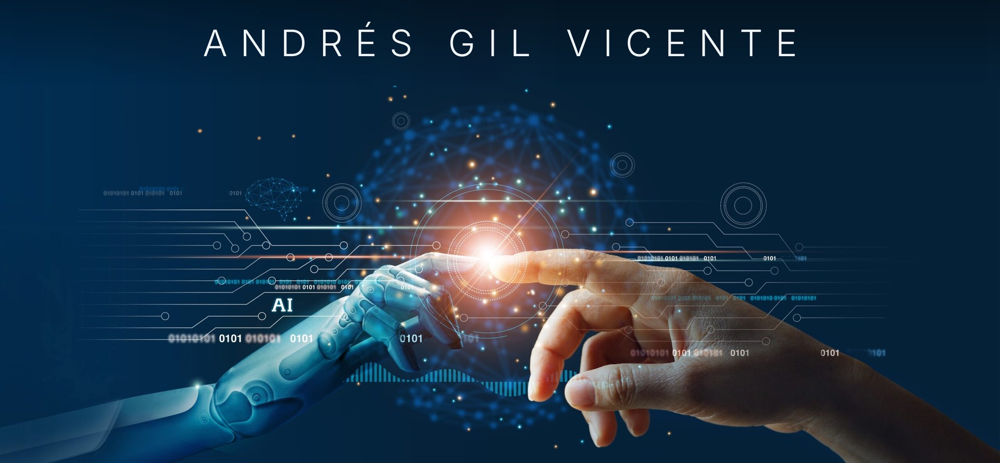

---

### Mathematical Engineering & AI Student - ICAI

Currently focusing on **Cloud Computing** and **Agentic AI**.  
I combine strong mathematical foundations with advanced programming to solve complex real-world problems.

---

### Skills & Tech Stack

#### Cloud & Data Engineering

  
  
  
  
  

#### Databases

  
  
  
  

#### AI, Machine Learning & Agents

  
  
  
  
  
  

#### Programming Languages

  
  
  
  
  

#### Tools & Analytics

  
  
  

---

### Featured Projects

<table align="center">
  <tr>
    <th>Project</th>
    <th>Description</th>
    <th>Stack</th>
  </tr>
  <tr>
    <td><b><a href="https://github.com/andresgilvicente/padel-ai-system">Padel AI System</a></b></td>
    <td>Autonomous chair umpire for padel. Validates serves (valid or fault) and enables secure access through geometric pattern recognition with a mobile camera.</td>
    <td><code>YOLOv8</code> <code>OpenCV</code> <code>Streamlit</code></td>
  </tr>
  <tr>
    <td><b><a href="https://github.com/andresgilvicente/ai-financial-news-alerts">AI Financial News Alerts</a></b></td>
    <td>NLP and Deep Learning course project. Generates financial alerts from news text and optional chart images, with entity recognition, sentiment analysis and chart captioning.</td>
    <td><code>PyTorch</code> <code>BiLSTM-CRF</code> <code>DePlot</code> <code>Qwen2.5</code></td>
  </tr>
  <tr>
    <td><b><a href="https://github.com/andresgilvicente/aws-crypto-medallion-pipeline">AWS Crypto Medallion Pipeline</a></b></td>
    <td>End-to-end crypto data platform on AWS. Bronze, Silver and Gold lakehouse with Glue, S3 and Athena, plus real-time VWAP streaming.</td>
    <td><code>S3</code> <code>Glue</code> <code>Athena</code> <code>Kafka</code> <code>Spark</code> <code>Timestream</code></td>
  </tr>
</table>

---

  
  

